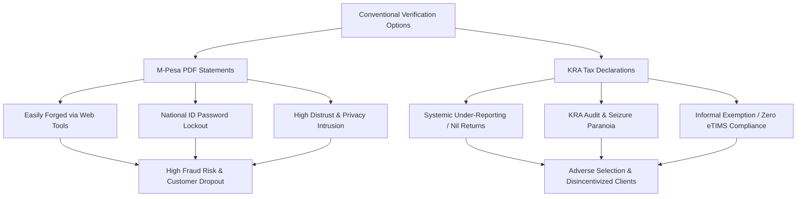
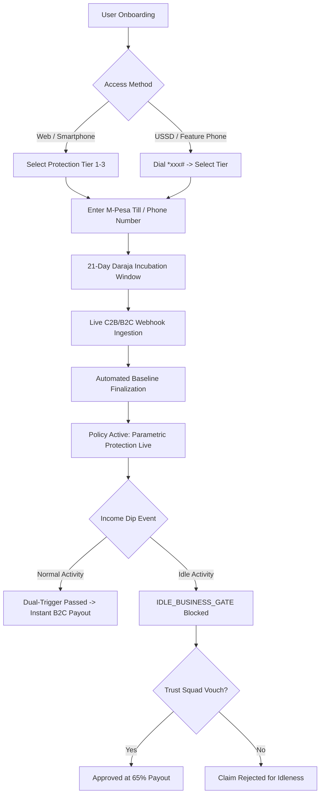

# Strategic Architecture: Zero-Document Underwriting for the Kenyan Informal Economy

**Project:** Income Deficiency Compensation System (IDCS)  
**Document Type:** Strategic Architecture & Underwriting Proposal  
**Target Market:** Kenyan Gig Workers, Micro-Merchants, and Informal Sector (*Jua Kali*) Operators  
**Date:** November 2026  

---

## Executive Summary

A critical bottleneck in expanding parametric income insurance to the Kenyan informal sector is the **verification paradox**:
* Traditional documentary proof (**M-Pesa PDF statements**) is trivially forged, technically exclusionary, and universally distrusted by micro-entrepreneurs.
* Formal statutory proof (**KRA iTax / eTIMS declarations**) fails because the majority of micro-enterprises under-report income, file Nil returns, or avoid government registry due to tax seizure fears.

This document outlines a **Zero-Document Underwriting Strategy** that eliminates the requirement for M-Pesa PDF uploads and KRA integration. By combining **Progressive Daraja API Observation**, **Fixed Parametric Tiers**, **Chama/SACCO Social Anchoring**, and **USSD Accessibility**, IDCS can achieve frictionless onboarding, mathematical tamper-resistance, and complete financial inclusion for remote and non-smartphone operators.

---

## 1. The Dual Failure of Conventional Verification



### 1.1 The M-Pesa PDF Breakdown
1. **Forgery Accessibility:** Free online PDF editors and canvas tools allow users to modify statement names, alter transaction amounts, or inject artificial high-value credits into Safaricom statement templates within minutes.
2. **The Safaricom Password Barrier:** Official M-Pesa statements are encrypted with the account holder's National ID number. Non-tech-savvy, elderly, or semi-literate users struggle to unlock, export, and upload these documents.
3. **Severe Privacy Friction:** An M-Pesa statement exposes all personal financial history, including family P2P transfers, hospital bills, emergency chama loans, and bet slips. Informal operators refuse to surrender this data to a web platform.

### 1.2 The KRA Integration Breakdown
1. **The "Nil Return" / Minimum Declaration Penalty:**  
   To secure mandatory Tax Compliance Certificates (TCC) or avoid penalties, informal operators routinely file Nil returns or report arbitrary minimal revenues (e.g., KSh 15,000–20,000/month).  
   * *The Penalty Trap:* An entrepreneur earning KSh 60,000 who declares KSh 20,000 to KRA would receive an IDCS dip payout of only KSh 14,000 (70% of 20,000) during a catastrophic drop. The worker perceives this as deeply unfair, resulting in immediate product abandonment.
2. **The KRA Audit Panic:**  
   Informal workers operate with an acute fear of KRA enforcement. Asking for a KRA PIN or tax integration during onboarding triggers an immediate assumption that IDCS is an intelligence-gathering proxy for tax authorities.
3. **Exclusion of the Unregistered:**  
   Hawkers, rural mama mbogas, and mobile mechanics frequently lack active eTIMS profiles or formal tax registration. Mandating KRA credentials excludes the exact demographic IDCS exists to protect.

---

## 2. The Four Pillars of Zero-Document Underwriting

To eliminate documentation friction while safeguarding the risk pool against adverse selection, IDCS adopts four complementary underwriting models:

---

### Pillar 1: Progressive Underwriting via Live Daraja Observation

Instead of requiring retroactive historical proof on Day 1, IDCS determines the baseline income ($\mu$) prospectively during an **Incubation Window**.

```
[Day 0: Onboarding]
  ├── User inputs M-Pesa Till / Paybill / Phone
  └── Policy status: INCUBATING (Covers catastrophic macro shocks only)
        │
        ▼
[Days 1–21: Live Stream Observation]
  ├── Safaricom Daraja pushes C2B/B2C transactions via HTTPS Webhook
  ├── Each transaction payload includes cryptographic Safaricom HMAC signature
  └── Engine records real transaction velocity, customer counts, and inflows
        │
        ▼
[Day 22: Full Parametric Activation]
  ├── Moving average (µ) established with 100% mathematical certainty
  ├── Risk baseline finalized: ZERO documents uploaded
  └── Full 70% income dip compensation shield becomes active
```

* **Tamper-Resistance:** Webhook data flows server-to-server directly from Safaricom (`POST /webhook/daraja`). No client-side manipulation is possible.
* **Natural Alignment with Grace/Waiting Periods:** Micro-insurance policies standardly enforce a 14–30 day deferred window before full dip claims can be filed. This window is repurposed to build the actuarial baseline.

---

### Pillar 2: Fixed Parametric Coverage Tiers (Self-Selected Cover)

Eliminates the need to compute an exact, bespoke baseline down to the cent. Instead, operators select a pre-calibrated **Parametric Shield Bracket** aligned with their visible business scale:

| Protection Tier | Benchmark Monthly Income | Monthly Micro-Premium | Maximum Dip Payout (70%) | Empirical Business Scale Indicator |
|:---|:---:|:---:|:---:|:---|
| **Tier 1 — Bronze** | KSh 25,000 | 1.2% per txn | **KSh 17,500** | Solo operator, single-chair barber, mobile cart |
| **Tier 2 — Silver** | KSh 50,000 | 1.5% per txn | **KSh 35,000** | 2–3 stations, rented physical stall, 1 assistant |
| **Tier 3 — Gold** | KSh 90,000 | 1.8% per txn | **KSh 63,000** | Multi-chair salon, high-traffic retail kiosk |

#### Solvency & Anti-Selection Rules:
* **Velocity Score Prerequisite:** A Tier 3 Gold policy requires an ongoing velocity score of $\ge 70$ (demonstrating consistent transaction volume). If transaction volume drops below the tier threshold without a macro shock, the tier automatically recalibrates to prevent over-insured moral hazard.
* **Downtime Co-Pay:** All payouts remain strictly capped at 70% of the selected tier's dip amount, guaranteeing that the operator always earns more by working than by claiming.

---

### Pillar 3: Social & Group Anchoring (Chama & SACCO Verification)

The informal economy in Kenya does not run on formal documentation; it runs on **social collateral and peer reputation**.

```
┌────────────────────────────────────────────────────────┐
│           Chama / SACCO / Stage Association            │
│  (e.g., Kasarani Barbers Guild / Stage 4 Bodaboda SACCO)│
└──────────────────────────┬─────────────────────────────┘
                           │
             Vouches for Baseline & Capacity
             (e.g., "Operates Chair 2; avg KSh 1,800/day")
                           │
                           ▼
┌────────────────────────────────────────────────────────┐
│                      Trust Squad                       │
│  • Group No-Claim Dividend (-0.3% premium discount)   │
│  • Peer Attestation for claims during zero-debit weeks │
│  • Collective peer review prevents fraudulent claims    │
└────────────────────────────────────────────────────────┘
```

1. **Institutional Onboarding:** SACCOs, chamas, and market associations register member cohorts via CSV or administrative portal. The association leadership certifies the typical income band for each member.
2. **Collective Incentive (No-Claim Dividend):** When a Trust Squad maintains a claim-free record for 12 months, every member receives a permanent **−0.3% reduction** in micro-premium deduction rates.
3. **Peer Policing:** Because an illegitimate payout drains the pool and threatens the squad's dividend, peers will not attest or vouch for an idle member who intentionally abandoned work.

---

### Pillar 4: Feature-Phone Inclusion via USSD (`*xxx#`)

To serve non-smartphone operators and remote rural communities with limited internet connectivity, IDCS exposes core operations through a lightweight USSD interface:

```text
**********************************
       IDCS BIMA YA GIG
**********************************
1. Check My Protection Status
2. Declare Weekly Cash Income
3. Trust Squad & Dividends
4. Report Income Shock / Dip
5. Request Peer Attestation
**********************************
Select Option (1-5):
```

* **No Smartphone Required:** Runs over standard GSM signaling on any feature phone (*Kabambe*).
* **Automatic Ingestion:** When clients pay via Lipa na M-Pesa Till or Paybill, Safaricom webhooks automatically reconcile the transaction without requiring the user to open any web browser.

---

## 3. Comparative Evaluation Matrix

| Evaluation Criteria | 1. M-Pesa PDF Upload | 2. KRA Tax Integration | 3. Progressive Daraja | 4. Parametric Tiers | 5. Social / Chama |
|:---|:---:|:---:|:---:|:---:|:---:|
| **Resistance to Forgery** | 🔴 Extremely Poor | 🟢 High | 🟢 Tamper-Proof | 🟢 High | 🟡 Medium-High |
| **Onboarding Friction** | 🔴 High (Password lock) | 🔴 Prohibitive | 🟢 Zero Documents | 🟢 Instant Selection | 🟢 Assisted Onboard |
| **User Trust / Privacy** | 🔴 Low (Surrenders P2P) | 🔴 Critical Fear | 🟢 High (Business txns only) | 🟢 Transparent | 🟢 High (Community) |
| **Informal Sector Fit** | 🟡 Moderate | 🔴 Complete Mismatch | 🟢 Native M-Pesa fit | 🟢 Highly accessible | 🟢 Culturally aligned |
| **Feature-Phone Compatibility** | 🔴 Incompatible | 🔴 Incompatible | 🟢 Fully Compatible | 🟢 Fully Compatible | 🟢 USSD / SMS Native |
| **Underwriting Speed** | 🟡 Immediate but flawed | 🟡 Slow API queries | 🟡 14–21 day window | 🟢 Immediate | 🟢 Instant via Cohort |

---

## 4. Implementation & Migration Architecture



---

## 5. Summary & Recommendation

1. **Deprecate Mandatory PDF Uploads:** Relegate PDF statement parsing to an optional secondary method for historical claims, removing it from the primary onboarding path.
2. **Abandon KRA Validation:** Eliminate KRA PIN requirements to remove registration friction, eliminate tax audit fears, and prevent under-declaration payout distortions.
3. **Adopt Progressive Daraja Onboarding:** Make live Safaricom webhook observation during a 14–21 day incubation window the primary mechanism for establishing baselines.
4. **Deploy Parametric Tiers:** Allow users to select clear, bounded coverage tiers (KSh 25k, 50k, 90k) backed by dynamic velocity scoring.
5. **Expand USSD Access:** Implement an Africa's Talking USSD gateway for `*xxx#` menu interactions, bringing non-smartphone operators into the scheme.
